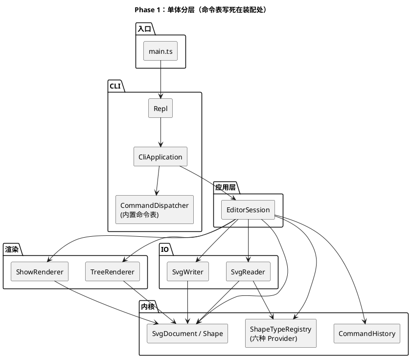
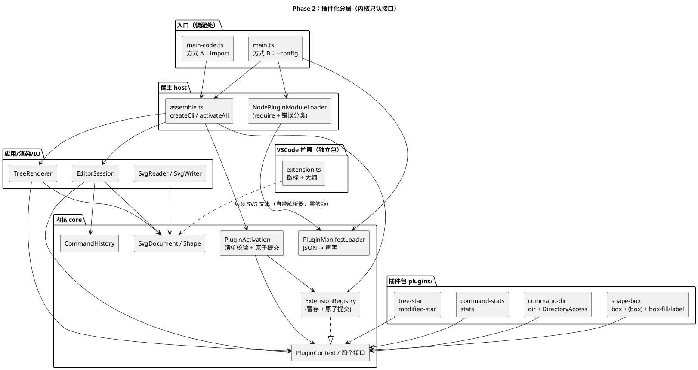

# svg-editor 项目文档（PJ1 Phase 1 + Phase 2）

> 本文档是课程的提交文档。第 1–4 节对应 Phase 1：**架构方案**、**与 AI 协作的过程记录**、**实现后的一致性自查**、**功能完整性与质量保证手段**；第 5 节对应 Phase 2：**扩展点设计**、**插件装配方式**、**重构前后的架构变化**、**设计决策**与**与 AI 协作的检查与修正**。仓库使用 git 管理并已推送到 GitHub（`github.com/audenduan/svg-editor`），提交历史体现完整开发过程，Phase 1 打 `final`/`v0.1.0` 标签，Phase 2 打 `p2` 标签。

## 0. 项目概述与需求范围

一个用 TypeScript 实现的命令行 SVG 编辑器：支持画布管理、六种图形类型的创建与层级组织、撤销/重做、SVG 文件读写、结构树与属性明细展示。零第三方运行期依赖（仅 `@types/node`、`typescript` 用于类型检查与编译）。

需求覆盖编号：0.1（交互输出示例）、1（图形层级）、2（命令与 id 语义）、3（类型与参数）、4.1~4.3（撤销/重做、错误表、文件操作后撤销被禁）、5.1~5.2（tree / show）、6（完整会话）、6.1（`in` 子句嵌套创建），以及架构要求（插件型图形类型、简单问题不引入依赖）。

---

## 1. 架构方案

### 1.1 分层架构

依赖方向自下而上，领域层（`core`）不依赖任何 IO / CLI 概念：

```
src/
├── core/            # 领域层
│   ├── model/       #   Shape 层级 + 复合容器（ShapeContainer）+ 几何运算 + 状态快照
│   ├── command/     #   命令对象（Command）+ 历史栈（CommandHistory）
│   ├── registry/    #   图形类型注册表 ShapeTypeRegistry（按名分派点之一）
│   └── errors/      #   EditorError——所有可预期失败的唯一类型
├── io/              # 手写 XML 解析器（io/xml/XmlParser）+ SvgReader/SvgWriter + FileStore
├── render/          # TreeRenderer / ShowRenderer：纯排版，内容来自图形的多态钩子
├── app/             # EditorSession：前置校验 + 命令包装 + io 闸门（应用层唯一门面）
└── cli/             # CommandLineTokenizer → CommandDispatcher → Repl
```

- **`core/model` 为什么单独一层**：图形本身的"是什么、能做什么"（移动、缩放、序列化、快照）与"命令怎么用"、"怎么显示"解耦。`Shape` 基类用"数值字段声明表"（`defineNumericField`）驱动 `moveBy/scaleBy/anchorPoint/序列化`，新增图形类型不需要改既有分支；几何值是子类私有字段（封装而非数据袋）。
- **`core/command` 与撤销**：每个编辑命令一个类，`execute()` 前对涉及的图形 `captureState()`，`undo()` 时 `restoreState()`（Memento 模式）。结构变化（delete/group/addto）由命令自己记录父容器与原下标，撤销时精确还原位置。
- **`core/registry` 插件化**：内置 6 种类型（rect/circle/ellipse/line/text/g）通过 Provider 注册；`BaseShapeProvider` 保证 `create`（命令行）与 `restore`（读 SVG）复用同一套属性白名单。
- **`app` 与 `cli` 分离**：`EditorSession` 是唯一门面，一条命令一个方法、返回面向用户的输出行；CLI 只做分词参数解析与错误前缀，不接触模型。

### 1.2 两处按名分派

架构方案要求"按名分派"集中且可扩展，全项目只有两个按字符串名字分派的对象：

1. **`ShapeTypeRegistry.createShape(typeName, …)` / `findByTag(tag)`**——图形类型。未知类型报错带插件提示：`unknown shape type: hexagon (is the plugin loaded?)`。注册新 Provider 即可获得 create / read（restore）/ save（序列化）/ tree 标注能力，不改任何现有代码。
2. **`CommandDispatcher`**——CLI 命令名 → handler。每个 handler 只做参数解析与个数校验，随后调用 `EditorSession`。

### 1.3 命令模式与快照式撤销

- 一条命令 = 一个撤销单元（包括 `create … in`、`group` 多成员收编、容器递归的 move/scale）。
- 快照包含几何、样式、保留属性（extra，如 transform）、文本内容，undo 是"整体还原"而非反向运算 → 无浮点累积误差，删除/恢复、重新分组都能精确还原。
- `CommandHistory` 维护 undo/redo 双栈：新编辑清空 redo 栈；`lockAfterIo()` 后拒绝 undo/redo，下一次 `run` 自动解锁；`resetAfterIo()` 整体清空。

### 1.4 io 闸门（需求 4.3）

文档类命令（`init / read / save / canvas`）之后 undo/redo 被禁止（`undo not allowed after io command`）；`init / read` 直接清空历史，`save / canvas` 只锁栈。这样保证"文件内容 ↔ 内存模型 ↔ 撤销栈"三者的边界清晰：IO 之后的历史不再有意义。

### 1.5 id 语义与属性通道

- **id（需求 2）**：显式 id 直接用；与已分配 id 重复 → 改名 `dup-2/-3…` 并警告；无 id → `标签名+序号`（`rect1`、`circle1`…），序号避开文件内所有显式 id，并警告。
- **属性三通道**（白名单只在 `Shape.setAttribute` 定义一处）：几何（数字、越权报错）、样式（fill/stroke/stroke-width）、extra（transform、font-size 等，round-trip 不丢）；text 类型另有文本内容通道。
- **协议**：`treeSummary()/showLines()/geometrySummary()/elementName()` 是多态钩子，render/io 只描述"怎么排版/怎么序列化"，不假设类型细节。

---

## 2. 与 AI 协作的过程记录

### 2.1 协作方式

本项目由本人提出需求与决策点、AI 辅助实现与质控的方式协作完成。约定如下：

- **分步提交**：整个开发拆成 12 个提交，每步 = 设计要点 → 实现 → 自检验证（按需求 transcript 逐行断言）→ 独立提交并推送，提交历史完整体现开发过程；
- **需求冲突先问不猜**：凡是需求文档有歧义的点（tree 对齐、show 的 line 属性、缺省画布、defs），先记录决策再实现，不留模糊地带；
- **测试优先回放**：以需求文档的完整会话 transcript 为准绳，先写逐行断言，再实现/修正；
- **自主纠错**：AI 自检发现的失败先归类（测试期望错误 vs 代码缺陷），修复后回归全绿。

### 2.2 分阶段开发记录（git 提交历史）

| 提交 | 内容 | 该步的关键验证 |
| --- | --- | --- |
| `320a9a6` | 脚手架（tsconfig/package.json/目录结构） | `npm run cli` 链路通（banner 输出） |
| `eb72672` | 图形层级与复合容器（Shape/ShapeContainer/6 类型） | 容器递归 move/scale 断言 |
| `54a356c` | 命令模式 + 撤销历史（10 个命令类 + CommandHistory） | undo/redo/清栈/io 闸门单测 |
| `51dcf91` | 图形类型注册表 + 6 个内置 Provider（schema 绑定） | 参数个数/非法数值/未知类型错误断言 |
| `33af332` | 手写 XML 解析器 + SvgReader/SvgWriter | writer 逐字比对、round-trip 逐字节稳定 |
| `3aa760a` | tree / show 渲染器 | 需求 6/6.1 transcript 逐行断言 |
| `6c17676` | EditorSession 应用门面（校验 + 编排 + io 闸门） | 30 项会话断言 |
| `ed9e3be` | CLI：分词/命令分发/REPL/help + main.ts 组装 | 需求 6 与 6.1 完整会话端到端回放 |
| `be4118f` | node:test 测试套件（54 用例） | `npm test` 全绿（54/54） |
| `21d6c8b` | 依赖纪律检查器（check-dependencies.mjs） | 流水线强制零第三方依赖 |
| `f09725d` | README + 本文档 | — |
| `0476dc4` | 示例脚本与样例 SVG（examples/） | 三个示例真实进程回放通过 |
| `（本次提交）` | 提交文档定稿（README 更新 + 本文档） | 全量回归 `npm test` 后打 `final` 标签 |

### 2.3 关键决策记录（人机分工）

| 决策点 | 需求原文情况 | 最终决策 | 理由 |
| --- | --- | --- | --- |
| `tree` 对齐 | 示例为手工排版、列宽不一 | 统一规则：同父兄弟取"有内联摘要的最长标签 + 2"为字段宽 | 程序必须输出确定列，不能"照着抄空格" |
| `show <line>` | 需求 5.2 规则"属性名=值" | 显示 `x1/y1/x2/y2` 与样式 | line 无画布别名，遵循通用规则 |
| `tree` 的 line 样式 | 6.1 示例省略 stroke | 显示 `stroke=black` | 样式内联是统一规则，判定示例为笔误 |
| read 缺省画布 | 0.1 示例无 width/height | viewBox 兜底 → 800x600 | 手写解析器需确定行为 |
| `defs`/元数据元素 | 需求未提及 | 本阶段跳过并警告 | Phase 1 不解析引用形状（渐变/滤镜），记录限制 |
| 带单位长度（300px） | 需求未提及 | 图形属性退化 0，根元素剥单位 | 数字模型无法表达单位，记录为已知 round-trip 限制 |
| ungroup 范围 | 4.2 提到根 svg 不可 ungroup | 只允许本阶段创建的 g；line/text 为复合图元拒绝 | 错误表语义 + 复合图元不可拆分 |
| 撤销实现 | 4.1 一条命令=一个单元 | 快照式 Memento 而非反向运算 | 容器递归/多成员收编/删除恢复天然精确，无浮点误差 |

### 2.4 过程中遇到的问题与解决

1. **验收脚本的"假失败"**：自检出现 3 个 FAIL，逐一排查后确认均为**测试脚本期望值写错**（对齐空格数、read 换文档后 parent 变化、重复 id 检查时机），不是代码缺陷；修正期望后全绿。真正改过的代码问题只有一处（help 中图形类型顺序 → 改为注册顺序）。
2. **Windows 中文脚本回放编码陷阱**：PowerShell 管道把 UTF-8 当 GBK 解码导致乱码。程序本身无问题（生成 SVG 经字节级校验为正确 UTF-8），win 下建议 `cmd` 重定向回放含中文脚本。
3. **git push 偶发 TLS 瞬断**：重试后成功，提交历史连续完整。
4. **`node --test` 目录参数**：Node 24 需传 glob（`dist/tests/*.test.js`）而非目录，已在 `npm test` 脚本修正。

---

## 3. 实现后的一致性自查

对照需求文档逐项自查（实现与原文的差异均已记录并给出理由）：

1. **`tree` 对齐为统一规则**：语义与需求 6/6.1 示例一致（每列的语义：类型#id、几何、样式），空格数不同（示例列宽不统一，无法照抄）；`tests/transcript.test.ts` 按本规则逐字断言。
2. **`show <line>` 用 `x1/y1/x2/y2`**：遵守"属性名=值"；tree 里用 `(x1,y1) -> (x2,y2)` 缩略展示方向。
3. **tree 内联样式含 stroke**：需求 6.1 示例省略，判定为笔误。
4. **read 缺省画布**：viewBox → 800x600 兜底。
5. **`defs` 与元数据跳过**：警告而非失败；`title/meta` 静默忽略；未知图形元素 `unsupported element <polygon> skipped`。
6. **带单位长度退化 0**：图形属性无法用数字表达（svg 根元素 width/height 剥 `px/pt/mm/cm/in`）。
7. **文本转义**：writer 转义（`& < >`），reader 反转义，round-trip 逐字节稳定。
8. **ungroup 范围**：仅本阶段创建的 g；line/text 复合图元拒绝；根级 g 报 `cannot ungroup top-level container`。
9. **错误不含糊**：`no such container` 与 `not a container` 分开报；group 祖先冲突按"成员容器含另一个成员"检查；错误信息与需求 4.2 逐字一致。
10. **失败不改状态**：所有校验在命令执行前完成，`error:` 行出现后文档结构与撤销栈完全不变（有专门测试断言）。

---

## 4. 功能完整性与质量保证手段

### 4.1 功能完整性：需求 → 实现 → 验证

| 需求 | 实现位置 | 验证 |
| --- | --- | --- |
| 0.1 交互输出示例 | `src/cli/Repl.ts`、`src/render/`、`src/io/SvgWriter.ts` | `tests/io.test.ts` writer 逐字比对 |
| 1 图形层级（嵌套、递归 move/scale、删除整棵子树） | `src/core/model/`（ShapeContainer） | `tests/command.test.ts` |
| 2 命令与 id 语义 | `src/app/EditorSession.ts`、`SvgReader.resolveId` | 自动补 id/改名警告断言 |
| 3 类型与参数（6 种 + schema 绑定） | `src/core/registry/*Provider.ts` | `tests/registry.test.ts`（含错误数量/非法数值） |
| 4.1 撤销/重做一格一格 | `src/core/command/*` | `tests/command.test.ts`（12 个语义用例） |
| 4.2 错误表逐字一致 | `EditorSession` 全部校验点 | `tests/errors.test.ts`（13 组） |
| 4.3 文件操作后撤销被禁 | `CommandHistory` io 闸门 | `tests/command.test.ts`、`transcript.test.ts` |
| 5.1 `tree` | `src/render/TreeRenderer.ts` | 需求 6/6.1 transcript 逐行 |
| 5.2 `show` | `src/render/ShowRenderer.ts` | `tests/transcript.test.ts` |
| 6 完整会话 | `EditorSession` + `cli/` | `tests/transcript.test.ts` 两段逐行 |
| 6.1 `in` 子句 | `CommandDispatcher` + `resolveContainer` | 同上 + 示例流程图回放 |
| 架构：插件型类型、按名分派 | `ShapeTypeRegistry`、`CommandDispatcher` | 注册表/分派测试 + 依赖纪律 |
| 架构：零第三方依赖 | `scripts/check-dependencies.mjs` | `npm test` 流水线强制 |

### 4.2 质量保证手段

- **分层测试**（`node:test`，内置框架，54 用例）：
  - 单元：几何运算与白名单（`geometry`）、撤销历史语义（`command`）、schema 绑定与 restore（`registry`）、XML 读写逐字节（`io`）；
  - 集成：需求 6/6.1 **完整会话逐行断言**（`transcript`）、需求 4.2 **错误表逐字断言**（`errors`）；
  - 支持件：`MemoryFileStore`（可开关写失败）、`BufferOutput`、`testHarness`——IO 失败路径不依赖真实文件系统。
- **依赖纪律**：`scripts/check-dependencies.mjs` 拒绝 package.json 白名单（`@types/node`、`typescript`）以外的依赖，并拒绝源码里非相对路径/非 `node:`/非内置模块的 import。
- **流水线**：`npm test` = `tsc`（strict 全开）→ 依赖检查 → `node --test`。任何代码提交前必须全绿。
- **灰度验证**：每个示例脚本（`examples/`）都真实进程回放；生成 SVG 做字节级 UTF-8 校验。
- **规模**：源码 + 测试约 3800 行（测试占 23%），单文件最大 307 行，无循环依赖。

---

## 5. Phase 2：插件实践与插件式重构

Phase 1 的四项要求（架构方案 / 与 AI 协作的过程记录 / 实现后的一致性自查 / 功能完整性与质量保证手段）即上文第 1–4 节。
Phase 2 在同一仓库继续演进：**① VSCode 扩展**（SVG 徽标 + 大纲），**② CLI 的插件式重构**（四个扩展点 + 两种装配方式 + 新插件验证）。

### 5.1 验收要求 → 交付物 → 证据

| 要求 | 交付物 | 证据 |
|---|---|---|
| VSCode 扩展：Explorer 徽标 + 大纲 | `vscode-svg/`（`extension.ts`、`svgParser.ts`、`outlineProvider.ts`） | 解析器 5 个用例；截图 `vscode-svg/screenshots/01-badge.png`、`02-outline.png`；激活日志 |
| 四个扩展点（图形 / 命令 / 树标签 / 属性） | `src/core/plugin/*`、`src/core/registry/ShapeProvider.ts` | [`extension-points.md`](extension-points.md)（接口、内核调用位置、缺省行为、违约报错）；`tests/extensions.test.ts` |
| 两种装配方式（改代码 / 改配置），行为一致 | `src/main-code.ts`、`src/main.ts --config`、根 `plugins.config.json` | `tests/assembly.test.ts`（真实进程逐字节）+ `scripts/compare-assembly.mjs`（3 个会话） |
| 新增插件验证设计（开闭原则） | `plugins/shape-box`、`plugins/tree-star`、`plugins/command-stats`、`plugins/command-dir` | `box` 接入提交 `c082226` 对 `src/` 的 diff 为空；`tree-star` 只用到通用钩子 |
| 保持原有功能行为不变 | 内核不含插件名分支 | Phase 1 用例断言一字未改即全绿；不加载插件时 `tree` 逐字节同 Phase 1 |
| 加载器健壮性 | `src/core/config/PluginManifestLoader.ts`、`src/core/plugin/PluginActivation.ts`、`src/host/NodePluginModuleLoader.ts` | `tests/configLoader.test.ts`（20 例）、`tests/pluginActivation.test.ts`（8 例）、`tests/assembly.test.ts`（14 例） |
| 文档 | 本文件 + `extension-points.md` + `iteration-report.md` + `adr.md` + `vscode-svg/*` | — |
| 提交历史与 tag | 12 个过程提交 + 最终 `p2` | `git log --oneline` |

### 5.2 重构前后的架构变化

**Phase 1（单体）**：`ShapeTypeRegistry` 在装配时注册六种图形，`CommandDispatcher` 里是**写死的命令表**，
新增一种图形或一条命令必须改内核与装配处两个地方。



**Phase 2（插件化）**：内核只认接口；装配被拆成"内核侧清单语义"与"宿主侧模块解析"两部分；
方式 A 与方式 B 都收敛到同一个激活与校验函数。



**变化点（逐条对照）**：

| 维度 | Phase 1 | Phase 2 | 为什么这么改 |
|---|---|---|---|
| 新增一种图形 | 改内核 `ShapeTypeRegistry` 的注册 + 装配处 | 只加一个插件包，`registerShapeProvider` | 内核不认识具体图形（ADR-1） |
| 新增一条命令 | 改 `CommandDispatcher` 的命令表 | 只加一个插件包，`registerCommand` | 命令表搬进 `CommandRegistry` |
| 树行尾标签 | 渲染器里没有这个概念 | `TreeDecorator` 接口 + 注册表；渲染器只拼字符串 | 展示性变化不该动内核 |
| 属性语义 | 白名单写死 | `AttributeHandler` 首个命中独占 | `fill` 在底板与文字上是两种东西 |
| 装配 | 一个入口 | 两个入口 + 唯一激活路径 | 两种方式必须逐字节等价（ADR-5） |
| 失败处理 | 没有"插件"这一层 | 六个固定文案 + 继续启动 | 规范 §6（ADR-9） |

### 5.3 四个扩展点（详见 [`extension-points.md`](extension-points.md)）

| # | 扩展点 | 插件实现它得到什么 | 内核调用位置 | 本次实现 |
|---|---|---|---|---|
| 1 | `ShapeProvider` | 新的图形类型（`create` 的参数 schema、从 SVG 还原） | `ShapeTypeRegistry.createShape` / `resolveProvider`；`SvgReader.readElement` | `box`（`<g>` 变体，靠 `data-kind` 区分） |
| 2 | `CommandExtension` | 新的 CLI 命令（自带 usage/summary） | `CommandDispatcher.find`；`CliApplication.executeLine` | `stats`、`dir` |
| 3 | `TreeDecorator` | 树行尾的附加信息 | `TreeRenderer.renderDocument/renderChildren/rootLine` | `box-type-label`（`(box)`）、`modified-star`（`*`） |
| 4 | `AttributeHandler` | 复合图形的属性语义 | `EditorSession.setAttribute`；`SetAttributeCommand.execute/undo` | `box-fill`、`box-label` |

四个注册方法都走同一套**暂存 + 原子提交**：`beginRegistration` → 插件 `activate` → 提交前校验
（重复注册 / 清单声明）→ `commitRegistration`，任一步失败就 `discardRegistration`，
不会留下"半个插件"。比较的是**暂存区**里的名字（`ExtensionRegistry.stagedNames()`），
所以清单校验发生在生效之前。

### 5.4 两种装配方式

```bash
# 方式 A：改代码（src/main-code.ts 里 import 插件，显式列出 contributions）
npm run build && npm run start:code

# 方式 B：改配置（仓库根 plugins.config.json）
npm run build && npm run start:config
```

清单结构（`version` 可省略；`entry`/`config` 是 `module`/`options` 的兼容别名）：

```json
{
  "plugins": [
    {
      "name": "@svgframe/plugin-shape-box",
      "module": "./dist/plugins/shape-box/src/index.js",
      "options": { "fill": "#f5a623" },
      "contributes": { "shapes": ["box"], "attributes": ["box-fill", "box-label"], "decorators": ["box-type-label"] }
    },
    { "name": "@svgframe/plugin-tree-star", "module": "./dist/plugins/tree-star/src/index.js",
      "contributes": { "decorators": ["modified-star"] } },
    { "name": "@svgframe/plugin-command-stats", "module": "./dist/plugins/command-stats/src/index.js",
      "contributes": { "commands": ["stats"] } },
    { "name": "@svgframe/plugin-command-dir", "module": "./dist/plugins/command-dir/src/index.js",
      "contributes": { "commands": ["dir"] } }
  ]
}
```

`module` 解析规则：`./` `../` 相对**配置文件目录**、绝对路径原样、其余按包名交给 Node 解析。
加载器里**没有**"插件名 → 路径"的映射表，因此接入新插件不需要改任何代码。

加载期失败的约定（规范 §6，全部**打印后继续启动**）：

```text
error: plugin not found: ./missing.js
error: plugin has no default export: ./nodefault.js
error: plugin manifest mismatch: liar (declared: shapes=[] commands=[a, b] decorators=[] attributes=[]; registered: shapes=[] commands=[a] decorators=[] attributes=[])
error: plugin failed to activate: boom (kaboom)
error: duplicate registration: commands/stats
error: invalid plugin config: <path>: <detail>
```

### 5.5 `dir`：把"既有代码"接进新扩展点的适配器模式

`dir` 是唯一依赖外部世界的插件，也是"适配器模式"的落点：

- **Target**：`DirectoryAccess { list(path): DirectoryEntry[] }`——命令逻辑只依赖这个接口；
- **Adaptee**：Node 的 `fs.readdirSync`（带 `withFileTypes`）；
- **Adapter**：`NodeDirectoryAccess` 把它适配成 `DirectoryAccess`，并在出错时统一抛 `EditorError`；
- **Client**：`createDirCommand({ directoryAccess, workingDirectory })`。

于是同一个命令实现有两种用法，**命令逻辑一行都不用改**：

| 场景 | 注入 | 验证 |
|---|---|---|
| 单元测试 | 测试替身（内存目录） | `plugins/command-dir/tests/dir.test.ts`：排序（目录在前）、隐藏项、空目录、`usage: dir`、错误包装 |
| 真实运行 | `new NodeDirectoryAccess()` + `process.cwd()` | `examples/` 回放与 `doc/transcript/cli-2.txt` |

插件自己在 `activate` 里装配适配器（`main.ts` 不参与），所以"注入哪个实现"是插件内部的事，
内核与装配处都不知道 `dir` 需要文件系统。`dir` 也不改文档、不影响 dirty 与 undo 历史——
这条由"未 `init` 也可用"和"之后 `tree` 输出不变"两处断言锁住。

### 5.6 开闭原则的两次验证

| 新插件 | 内核改动 | 证据 |
|---|---|---|
| `box`（复合图形 + 标签变体 + 两个属性处理器 + 树标签） | **0 行** | `git show --stat c082226 -- src` 输出为空 |
| `tree-star`（`modified-star` 标签） | 只用到上一阶段预置的通用钩子 `onEdited`（`EditorSession.run` 广播"哪些 id 被改过"），渲染器与装饰器接口之外**没有改动** | `plugins/tree-star/` 全部是新增文件；`TreeRenderer` 未改 |

`tree-star` 的设计要点（详见 ADR-10）：

- dirty 语义选"**发生过编辑命令**"：`undo` 回到保存点后 `*` 仍在（另一套"内容比对"语义的取舍写在 ADR）；
- 祖先传播：容器行若子树里有脏图形也标 `*`（`hasDirtyDescendant`），否则折叠树上看不出变化；
- 多标签顺序 = 注册顺序：生产配置里 `box` 在前，所以同一行是 `(box) *`；
- 状态全部在实例字段里（`dirty: Set<string>` + `rootDirty`），没有模块级变量，两个实例互不干扰。

```text
svg (400x200) *
└── g#outer *
    └── box#n1 (box) *
        ├── rect#n1-rect   x=10 y=20 w=100 h=40 fill=#223344
        └── text#n1-label  (18,44) "开始节点"
```

### 5.7 设计决策索引（[`adr.md`](adr.md)）

| ADR | 决策 | 一句话理由 |
|---|---|---|
| 1 | 扩展点用**接口 + 注册表**，不用继承/事件总线 | 内核只需查表，插件之间零耦合 |
| 2 | 注册用**暂存区 + 原子提交** | 半套注册比不注册更糟 |
| 3 | `box` 复用 `<g>` 标签，靠 `data-kind` 区分 | SVG 里没有"框"这个元素 |
| 4 | 属性处理器**首个命中独占** + 子树快照保 undo | 插件只管"改哪些字段"，事务归内核 |
| 5 | 两种装配共用 `activateChecked`，用**真实进程**证明等价 | 手工比对不可重复 |
| 6 | 清单加载器在**内核**，模块加载在**宿主** | 内核不该知道 `require` |
| 7 | 为"零内核改动"**预先**准备通用钩子 | 事到临头加钩子就等于改内核 |
| 8 | 复合图形保护契约覆盖**四类**改写 | 只防"离开"会漏掉"进来"和"重排" |
| 9 | 加载期失败**继续启动**，只有用法错退出 | 规范 §6 的硬要求；错误靠**文案精度**而非中止进程区分 |
| 10 | `modified-star` 用"**发生过编辑命令**"语义 | 不需要内容快照，四个分支都能独立断言 |

### 5.8 与 AI 协作：检查与修正记录

Phase 2 的协作方式与 Phase 1 相同（人定契约与判据、AI 写实现、人验收），但**AI 犯错的类型变了**：
Phase 1 的错误多是"实现写错"，Phase 2 的错误多是"**实现跑得通但不符合契约**"——
这类问题测试全绿也发现不了，只能靠"拿规范逐条核对"。下表是完整记录（含 Phase 2 前后的两轮）：

| # | 阶段 | AI 的产出 | 人的检查方式 | 发现的问题 | 修正 |
|---|---|---|---|---|---|
| 1 | 框架 | 四个扩展点 + 注册表 | 读代码 + 问"内核知不知道 box" | 注册表里混进了具体类型名的判断 | 抽出 `ShapeTypeRegistry` 查表，内核零分支 |
| 2 | 框架 | 复合图形保护 | 写探针脚本"攻击"不变量 | 只防"子部件离开"，能往 box 里塞第三个子部件、能重排 | 契约补全为四类操作（ADR-8） |
| 3 | 装配 | 配置加载器 | **逐条核对规范 §6 的六条文案** | 自造文案（`cannot load plugin …`） | 全部换成规范原文 |
| 4 | 装配 | 模块加载器 | 判据原文："加载器不得硬编码具体插件的分支或映射表" | 内建了 `builtin:shape-box → 路径` 的**名称映射表** | 删表，说明符原样交宿主解析 |
| 5 | 装配 | 清单加载 | 判据原文："声明与实际注册必须一致" | 没有 `contributes`，也没有比对 | 新增 `activateChecked` + `compareContributions`（四类逐类比对、顺序无关） |
| 6 | 装配 | 失败策略 | 判据原文："继续启动，主程序不得退出" | debug 阶段被改成"失败即退出" | 改回继续启动，仅用法错退出 2（ADR-9 重写） |
| 7 | 配置 | `config/plugins.json` 与 `entry`/`config` 键名 | 对照规范给的清单结构 | 目录与键名都不符 | 根 `plugins.config.json` + `module`/`options`/`contributes`，旧键名留兼容别名 |
| 8 | 插件 | `modified-star` 只在测试里作为匿名对象 | 判据原文："`*` 状态封装在装饰器实例里 + 独立插件 + 独立测试" | 不是插件、没有 `contributes`、没有独立测试 | 新建 `plugins/tree-star`，补 7 个状态机用例 |
| 9 | 插件 | `box-fill` 顺手改标签字色 | 对照规范 §3.1 的"实际修改"一栏 | 多改了注释里没有声明的子部件 | 收敛为只改底板（ADR-4 补充） |
| 10 | 扩展 | VSCode 选择器 `**/*.svg` | 用户实测"打不开、没有大纲" | 工作区**根目录**的 `a.svg` 匹配不到 | 补 `{ pattern: '*.svg' }`（提交 `72fec8a`） |
| 11 | 扩展 | 诊断命令 | 编译报错 | 用了本地 `vscode.d.ts` 桩里不存在的 API | 删除该命令，源码回到干净状态 |
| 12 | 文档 | 指标与用例数 | 脚本重算 + 抽查 | 数字手填、与脚本输出不一致 | 全部改为 `scripts/metrics.mjs` 生成（不允许手填） |

**三条经验**（也是这一阶段对"如何与 AI 协作"的回答）：

1. **判据必须是可机械检查的原文**。"代码里有没有那张映射表""失败后进程是否退出"这类问题，
   追问 AI"你确定吗"没有意义，直接 `grep` 与看退出码才有意义。因此本轮新增了
   `check-layers.mjs`（分层）、`compare-assembly.mjs`（双装配）、`metrics.mjs`（指标）三个机械判据。
2. **"更聪明的做法"要先当嫌疑犯**。AI 主动加的对比色、fail-fast、诊断命令，三个都被回退了：
   前两个超出规范给定的行为契约，第三个超出了桩代码的能力边界。改动的正当性只能来自规范原文。
3. **测试全绿 ≠ 符合契约**。8 处违规里有 6 处是测试全绿的情况下被文档核对抓出来的；
   反过来，一旦把规范文案写进断言（`plugin not found: …` 等），实现偏离就会立刻变红。

### 5.9 测试与验证材料

```bash
npm test                      # tsc → 零依赖 → 分层 → 148 个用例
npm run test:vscode           # VSCode 扩展解析器用例
node scripts/compare-assembly.mjs   # 双装配逐字节（3 个会话）
npm run metrics               # 重新生成 docs/metrics（从 git 历史算，不接受手填）
```

| 材料 | 位置 |
|---|---|
| 插件与加载器测试 | `tests/configLoader.test.ts`（20）、`tests/pluginActivation.test.ts`（8）、`tests/assembly.test.ts`（14）、`plugins/*/tests/*.test.ts`（11） |
| 功能兼容性 | `tests/transcript.test.ts`（Phase 1 断言未改）、`tests/composition.test.ts`（缺插件退化到基线） |
| 双装配一致性 | `tests/assembly.test.ts` + `scripts/compare-assembly.mjs` + `doc/transcript/cli-{1,2,3}.txt` |
| VSCode 扩展 | `vscode-svg/tests/`（解析器 5 例）、`vscode-svg/screenshots/01-badge.png`、`02-outline.png` |
| 架构与决策 | 本文件 §5.2–5.7、[`extension-points.md`](extension-points.md)、[`adr.md`](adr.md)、[`iteration-report.md`](iteration-report.md) |

### 5.10 指标（`docs/metrics/metrics.md`，由脚本从 git 历史生成）

| 类别 | 基线 `final` | 当前 | 说明 |
|---|---|---|---|
| 内核（core/app/io/render） | 2593 行 | 3711 行 | 增量集中在四个接口、两个注册表、激活校验与编辑信号广播 |
| 装配处（cli/host/入口） | 431 行 | 709 行 | 清单加载桥接 + 第二个入口 + 失败策略 |
| 插件（plugins/） | 0 | 1049 行 | 4 个插件包（含各自测试） |
| VSCode 扩展 | 0 | 604 行 | 扩展本体 + 解析器 + 用例 |
| 其他（测试/脚本/文档） | 955 行 | 2065 行 | 新增 22 个测试与 3 个判据脚本 |

Phase 2 之后仍未覆盖的候选方向：`defs` 引用解析、单位长度入模型、`up/down` 完整语义、撤销树 / 多文档。

