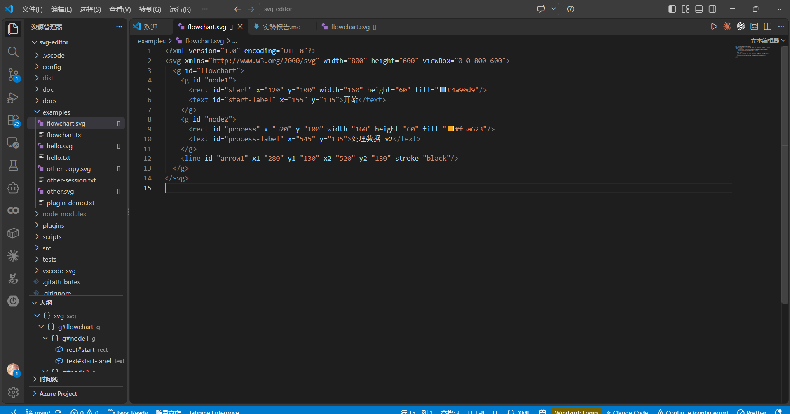
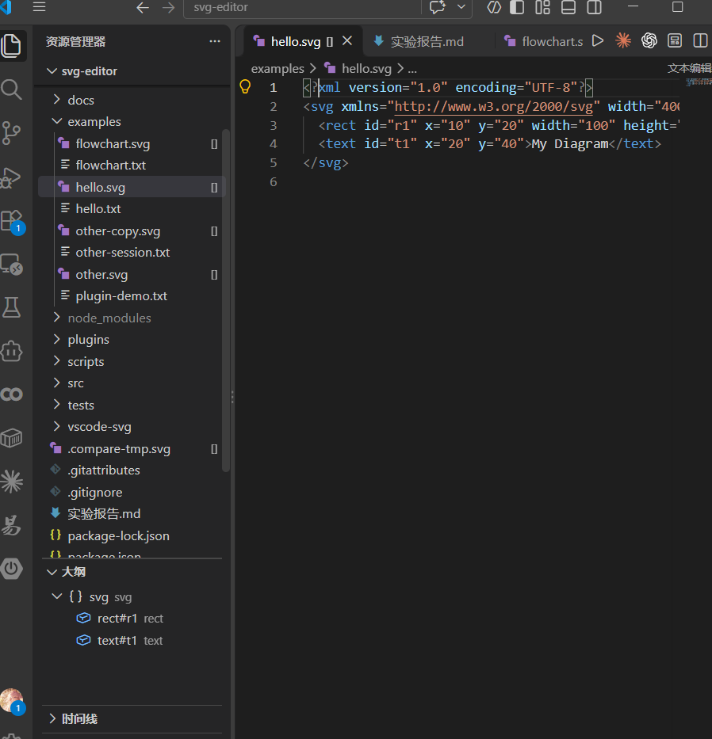

# SVG Outline & Badge — VSCode 扩展（PJ1 Phase 2 · A.1 / A.2）

一个**独立的 VSCode 扩展**，为 `svg-editor` 仓库提供两项只读的结构化能力：

- **A.1 文件标记**：在资源管理器（Explorer）中，让 `.svg` 文件名右侧显示 `[]` 徽标。
- **A.2 SVG 大纲**：为 `.svg` 文本文件提供 `DocumentSymbolProvider`，在 VSCode 原生“大纲（Outline）”视图里展示元素嵌套层级。

> 本目录（`vscode-svg/`）是完全自包含的：不修改仓库根目录任何文件，不依赖 CLI 的装配代码，也不引入任何第三方运行时依赖。仅借用仓库根 `node_modules/typescript` 在编译期使用。

---

## 1. 功能说明

### A.1 文件标记（`src/fileDecorationProvider.ts`）

- 通过 `vscode.window.registerFileDecorationProvider` 注册一个 `FileDecorationProvider`。
- `provideFileDecoration(uri)` 只对**文件**且**扩展名是 `.svg`（大小写不敏感）**返回：

  ```ts
  { badge: '[]', tooltip: 'SVG file' }
  ```

  其余（目录、非 svg 文件）一律返回 `undefined`。
- **目录不加标记**：先按扩展名快速过滤，再用 `workspace.fs.stat(uri)` 确认 `stat.type === FileType.File`（这样即使有名字叫 `foo.svg` 的目录也不会误加）。
- **不改文件名、不改文件内容**，只是“附加显示信息”。
- **刷新**：通过 `onDidChangeFileDecorations`（内部 `EventEmitter<Uri | Uri[] | undefined>`）在以下时机通知 VSCode 重算：
  - `workspace.onDidSaveTextDocument`（保存 `.svg` 文档时）；
  - `workspace.onDidCreateFiles` / `workspace.onDidDeleteFiles`（文件增删时）；
  - 手动命令 **`SVG: Refresh File Decorations`**（`svgEditor.refreshDecorations`，全量刷新兜底，`fire(undefined)`）。

### A.2 SVG 大纲（`src/outlineParser.ts` + `src/outlineProvider.ts`）

- **纯函数解析器** `parseSvgOutline(text: string): OutlineNode[]`：
  - `OutlineNode = { tag; id; name; startOffset; endOffset; children }`；
  - 节点名：有 `id` 属性为 `tag#id`（如 `rect#start`），否则为标签名（如 `text`）；
  - 嵌套：`<svg>` 为根，`<g>` 等容器为父节点，叶子为子节点，逐层嵌套；
  - 偏移：`startOffset`/`endOffset` 覆盖该元素**整段源码**（起标签 `<` 到闭标签 `>` 之后）；自闭合元素只覆盖它本身。
- **provider** `SvgOutlineProvider implements DocumentSymbolProvider`：
  - `range` = 整段源码区间（`positionAt(startOffset)`→`positionAt(endOffset)`）；
  - `selectionRange` = 开始标签区间（点击节点选中/跳转到开始标签）；
  - 容器节点用 `SymbolKind.Object`，叶子用 `SymbolKind.Field`。
- **编辑后自动更新**：VSCode 在文档变化时会重新调用 `provideDocumentSymbols`，每次都用 `document.getText()` 的**最新文本**重新解析，因此无需额外监听。
- **残缺 XML 不崩溃**：`parseSvgOutline` 内部 `try/catch`，任何解析错误（未闭合、标签不匹配、多余结尾标签等）都返回 `[]`；provider 再兜底一层 `try/catch`，绝不把异常抛给 VSCode（允许大纲临时清空）。

> 说明：解析逻辑刻意与 `vscode` 解耦（`outlineParser.ts` 不 import `vscode`），因此可以被 `node:test` 无头测试。详见 [`analysis.md`](./analysis.md) 第 3 节对“为什么不直接复用 Phase 1 的 `XmlParser`”的说明。

---

## 2. 编译

扩展是 TypeScript 源码，运行前必须先编译出 `dist/`。使用**仓库根**自带的 TypeScript（5.9.x），**不安装任何 npm 依赖**：

```powershell
# 在仓库根 svg-editor/ 下执行
node "C:\Users\34817\Documents\deepseek-harness\默认工作区\svg-editor\node_modules\typescript\bin\tsc" -p vscode-svg/tsconfig.json
```

`tsconfig.json` 关键设置：`target ES2022`、`module commonjs`、`strict`、`rootDir "."`、`outDir "dist"`，`include` 为 `src/**/*.ts`、`tests/**/*.ts`、`types/**/*.d.ts`。编译产物结构：

```
vscode-svg/dist/
  src/extension.js
  src/fileDecorationProvider.js
  src/outlineParser.js
  src/outlineProvider.js
  tests/outlineParser.test.js
```

（`types/vscode.d.ts` 只是编译期声明，不产生输出；扩展清单 `main` 指向 `./dist/src/extension.js`。）

---

## 3. 测试

测试在**编译后的 JS** 上运行（`node:test` + `node:assert/strict`），不 import `vscode`，因此无需 VSCode 环境：

```powershell
# 1) 先编译（同上）
node "C:\Users\34817\Documents\deepseek-harness\默认工作区\svg-editor\node_modules\typescript\bin\tsc" -p vscode-svg/tsconfig.json

# 2) 跑测试
node --test "vscode-svg/dist/tests/*.test.js"
```

**实测输出**（本机，Node v24.10.0 / TypeScript 5.9.3）：

```
✔ 1) 嵌套分组：svg > g > rect/text 层级与父子关系正确 (2.0428ms)
✔ 2) 无 id 元素：name 只有标签名，id 为 null (0.212ms)
✔ 3) 文本变化后再解析：两次解析同一文档的不同版本，结果随之变化 (0.2218ms)
✔ 4) 不完整 XML 不抛异常，返回数组 (1.1681ms)
✔ 4b) 完整但被截断的文档：根仍可解析时返回空或部分结果 (0.1848ms)
ℹ tests 5
ℹ suites 0
ℹ pass 5
ℹ fail 0
ℹ cancelled 0
ℹ skipped 0
ℹ todo 0
ℹ duration_ms 99.5405
```

覆盖点对应需求：

1. **嵌套分组**：`svg > g#flowchart > g#node1 > rect#start / text#start-label` 层级与父子关系，并校验源码偏移切片与区间端点；
2. **无 id 元素**：`name` 只含标签名，`id === null`；
3. **文本变化后再解析**：同一文档两个版本分别解析，结果（子节点集合、`<text>` 区间长度）随最新文本变化；
4. **不完整 XML**：`<svg><g><rect id="a"`、`<svg></svg></g>`、标签不匹配、空文档等均**不抛异常**，返回数组。

---

## 4. 在 VSCode 里启动（Extension Development Host）

编译完成后，有两种方式加载本扩展：

### 方式 A：F5 调试（推荐）

1. 用 VSCode 打开仓库根目录 `svg-editor/`；
2. 打开 **运行和调试（Run and Debug）**，选择 “Extension” 环境（若未自动生成，可在 `.vscode/launch.json` 里配置 `"type": "extensionHost", "args": ["--extensionDevelopmentPath=${workspaceFolder}/vscode-svg"]`）；
3. 按 **F5**，会弹出新的 **Extension Development Host** 窗口，扩展在其中生效。

> 注意：本作业约束不允许改仓库根文件，因此**不提交** `.vscode/launch.json`；如需 F5，请在本机临时创建，或用下方命令行方式。

### 方式 B：命令行加载

```powershell
# 先编译
node "C:\Users\34817\Documents\deepseek-harness\默认工作区\svg-editor\node_modules\typescript\bin\tsc" -p vscode-svg/tsconfig.json

# 用绝对路径加载扩展（--extensionDevelopmentPath 需要绝对路径）
code --extensionDevelopmentPath="C:\Users\34817\Documents\deepseek-harness\默认工作区\svg-editor\vscode-svg" "C:\Users\34817\Documents\deepseek-harness\默认工作区\svg-editor"
```

在新窗口里打开 `examples/flowchart.svg` 即可看到徽标与大纲。

---

## 5. 手动截图步骤（用 `examples/flowchart.svg` 演示）

### 5.0 先启动 Extension Development Host（这一步最容易走错）

**前提**：必须在 VSCode 里**打开整个仓库文件夹**（`svg-editor`），而不是只打开一个 `.svg` 文件。
只打开文件时 VSCode 没有工作区，左侧 Explorer 显示 “You have not yet opened a folder”，
而 `.svg` 徽标是挂在**文件树条目**上的装饰，没有文件树自然就看不到徽标。

方式一（推荐，仓库已内置 `.vscode/launch.json`）：

1. VSCode 里 `文件 → 打开文件夹`，选择仓库根目录 `svg-editor`；
2. 按 **F5**，选择配置 **「运行 svg-editor 扩展（F5）」**；
3. 自动先编译扩展（任务 `build-vscode`），再弹出一个标题为 `[Extension Development Host]` 的新窗口，
   该窗口已经打开了 `examples` 文件夹。

方式二（命令行）：

```powershell
code --extensionDevelopmentPath="$PWD/vscode-svg" "$PWD/examples"
```

注意最后一个参数是**文件夹** `examples`（也可以是仓库根目录），不是 `examples/flowchart.svg`。

方式三（**最省事，不需要 F5，也不需要开发宿主窗口**）：把编译产物装进本机扩展目录，
然后**完全退出并重新打开** VSCode，扩展会像普通插件一样加载（`activationEvents: ["*"]`）：

```powershell
node node_modules/typescript/bin/tsc -p vscode-svg/tsconfig.json
$dest = Join-Path $env:USERPROFILE ".vscode\extensions\svg-editor-pj1.svg-outline-badge-0.1.0"
New-Item -ItemType Directory -Path $dest -Force | Out-Null
Copy-Item vscode-svg\package.json $dest
Copy-Item vscode-svg\dist $dest\dist -Recurse
```

卸载：删掉上面那个目录，重启 VSCode。

> **为什么大纲会是空的**：`registerDocumentSymbolProvider` 的选择器必须命中文件的**相对工作区路径**。
> 直接把 `examples/` 当工作区打开时，`flowchart.svg` 的相对路径就是 `flowchart.svg`，
> 只有 `**/*.svg` 可能不匹配零级目录——所以扩展同时注册了 `*.svg`、`**/*.svg` 和 `language: 'xml'` 三种选择器。
> 若大纲仍显示「活动编辑器无法提供大纲信息」，先确认窗口里有本扩展（`Developer: Show Running Extensions`）。

> 找不到 Explorer？它在左侧活动栏最上方（两个文件叠在一起的图标），快捷键 `Ctrl+Shift+E`。
> 中文界面的命令面板按**中文**标题匹配：找大纲要输「大纲」，不是 `outline`；
> 也可以直接按 `Ctrl+Shift+O`（转到文件中的符号），它用的是同一个符号 provider。
> 如果它在别的侧栏里，`查看 → 资源管理器` 可以重新调出来。

`examples/flowchart.svg` 已存在于仓库中（14 行），内容结构为：

```
<?xml version="1.0" encoding="UTF-8"?>
<svg …>                       ← 第 2 行
  <g id="flowchart">          ← 第 3 行
    <g id="node1">            ← 第 4 行
      <rect id="start" …/>    ← 第 5 行
      <text id="start-label">开始</text>   ← 第 6 行
    </g>
    <g id="node2">
      <rect id="process" …/>
      <text id="process-label">处理数据 v2</text>
    </g>
    <line id="arrow1" …/>
  </g>
</svg>
```

**步骤：**

1. 启动 Extension Development Host（见 §5.0），确认新窗口的 Explorer 里能看到 `examples` 文件夹。
2. **截图 1（A.1 徽标）**：在左侧 **Explorer** 里展开 `examples/`，可见 `flowchart.svg` 文件名右侧出现灰色 `[]` 徽标；同目录的 `flowchart.txt`、`hello.txt` **没有**徽标。鼠标悬停 `flowchart.svg` 显示提示 **“SVG file”**。
3. **截图 2（A.2 大纲）**：打开 `examples/flowchart.svg`，展开 VSCode 原生 **Outline（大纲）** 视图（`查看 → 打开视图 → 大纲`），应看到层级：

   ```
   svg
     └─ g#flowchart
          ├─ g#node1
          │    ├─ rect#start
          │    └─ text#start-label
          ├─ g#node2
          │    ├─ rect#process
          │    └─ text#process-label
          └─ line#arrow1
   ```

4. **截图 3（跳转验证）**：在大纲里点击 `rect#start`，光标应跳到源码 **第 5 行**（`<rect id="start" …/>`）；点击 `text#process-label` 跳到 **第 10 行**。
5. **截图 4（健壮性，可选）**：在编辑器里把某个 `>` 删掉制造残缺 XML，大纲应**临时清空但不报错/不崩溃**；补回后大纲自动恢复。

### 5.1 已归档的截图

#### 图 A.2：原生大纲视图



*图 A.2：`examples/flowchart.svg` 在文本编辑器状态下，左下角原生 **Outline** 视图显示
`svg > g#flowchart > g#node1 > rect#start / text#start-label`，有 id 的元素显示为 `标签名#id`，
右侧为对应源码（第 5 行起）。*

> 注：`.svg` 若被 image preview 等**自定义编辑器**接管，活动编辑器就不是 `TextDocument`，
> 大纲会显示「活动编辑器无法提供大纲信息」；按 §5.0 的说明切回「文本编辑器」即可。
> 这是运行期才暴露的约束，已记入 `analysis.md` §1.3。

#### 图 A.1：Explorer 文件徽标



*图 A.1：左侧 Explorer 中 `examples/` 下的 `.svg` 文件右侧显示图形数量徽标，
同目录的 `.txt` 文件没有徽标——文件类型由选择器（`**/*.svg` + 根级 `*.svg`）与文档语言共同判定。*

---

## 6. 目录结构

```
vscode-svg/
├── package.json                 # 扩展清单（engines.vscode ^1.85.0，main ./dist/src/extension.js，activationEvents ["*"]）
├── tsconfig.json                # 独立编译配置（ES2022 / commonjs / strict / outDir dist）
├── README.md                    # 本文件
├── analysis.md                  # A.3 三段分析
├── types/
│   └── vscode.d.ts              # 手写最小 vscode 类型声明（本机无 @types/vscode）
├── src/
│   ├── extension.ts             # activate/deactivate，注册两个 provider
│   ├── fileDecorationProvider.ts# A.1 文件装饰 provider（[] 徽标）
│   ├── outlineParser.ts         # A.2 纯函数解析器（不 import vscode）
│   └── outlineProvider.ts       # A.2 OutlineNode → DocumentSymbol
└── tests/
    └── outlineParser.test.ts    # node:test 无头测试
```
